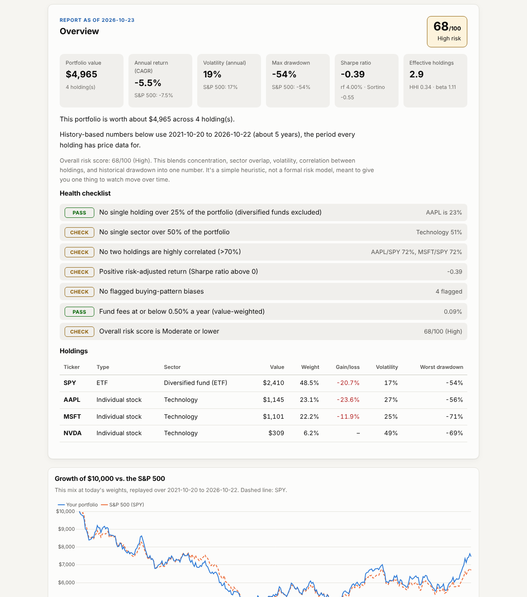
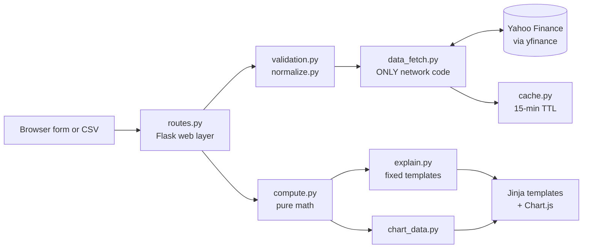
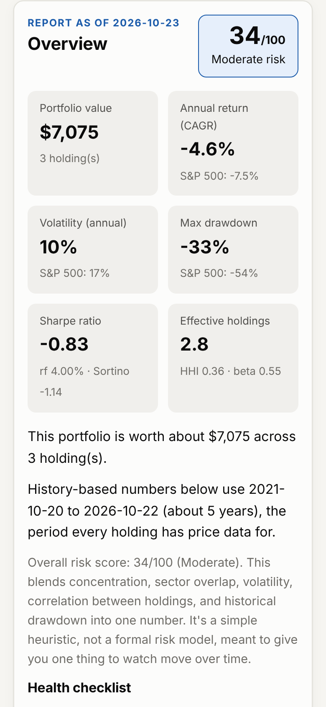

# Translate My Portfolio

[](https://github.com/aubreypkenton-jpg/translate-my-portfolio/actions/workflows/test.yml)


**Live demo:** https://translate-my-portfolio--aubreypkenton.replit.app

Type in what you own and get a plain-English risk report, computed from real price history and
benchmarked against the S&P 500. Every number traces to a formula on the
[methodology page](https://translate-my-portfolio--aubreypkenton.replit.app/methodology), and every
sentence is a fixed template: there is **no generative AI anywhere** in the calculations or the wording.



## What the report covers

| Area | What it tells you |
|---|---|
| Concentration | Largest single stock, sector and asset-class mix, Herfindahl-Hirschman index and "effective number of holdings" |
| Risk and return | CAGR, annualized volatility, maximum drawdown, Sharpe and Sortino ratios (with your own risk-free rate), beta |
| Vs. the S&P 500 | Every metric side by side with SPY over exactly the same dates, plus growth-of-$10,000 and drawdown charts |
| Hidden overlap | Correlation heatmap and plain-English flags for holdings that move together |
| Crash history | What this exact mix did in the 2020 COVID crash and the 2022 bear market, next to the S&P 500 |
| Funds | Expense-ratio and dividend-yield flags for ETFs and mutual funds, estimated annual fees |
| Taxes | Short- vs long-term status (IRS "more than one year" rule), days until long-term, unrealized gain or loss, wash-sale note |
| Behavior | Recency bias, loss aversion, and "fast, big bet" flags from your own purchase dates and prices |
| What if I rebalance? | Trades needed to reach target weights and a before/after comparison of every metric |

No login, nothing stored, no brokerage connection, and no incentive to get anyone to trade.
**Educational only; not investment, tax, or legal advice.**

## Run it locally

```bash
python -m venv .venv && source .venv/bin/activate   # Windows: .venv\Scripts\activate
pip install -r requirements-dev.txt
python run.py                                       # http://localhost:8080
pytest                                              # 216 tests, coverage gate 85%
ruff check .                                        # lint
```

No API keys are needed. Market data comes from Yahoo Finance through the free `yfinance` library.

## Deploy (free)

All hosts run the same production server (`gunicorn -c gunicorn.conf.py run:app`), which reads the
port from the `PORT` environment variable. `GET /health` returns `{"status": "ok"}` for uptime checks.

### Replit (keeps the existing `.replit.app` link)

1. Open the **existing** Repl that owns `translate-my-portfolio--aubreypkenton.replit.app` (importing a
   new Repl would create a new address).
2. In the Git pane, pull the latest `main` from GitHub (or delete the old files and re-import them).
3. Click **Run** to check it starts; the included `.replit` file serves it on port 8080.
4. Open **Publish** (Deployments), choose **Autoscale**, and publish. The `.replit` file already sets the
   build command (`pip install -r requirements.txt`) and run command (gunicorn).
5. Visit `/health`, then run an example portfolio.

> Replit's free Starter plan takes a published app down after 30 days, which is why the old link stopped
> working. Republish monthly (a calendar reminder works) or upgrade to Replit Core to keep it up permanently.

### Render (backup or long-term link)

1. Sign in at render.com with GitHub, then **New > Blueprint** and pick this repo. `render.yaml` sets up a
   free Docker web service with a `/health` check.
2. Wait for the first build (a few minutes), then open the `onrender.com` URL.
3. Optional: free services sleep after 15 minutes idle and take about a minute to wake. To keep it warm
   during business hours, add a repository variable `APP_URL` (Settings > Secrets and variables >
   Actions > Variables) with the Render URL; `.github/workflows/keep-warm.yml` pings `/health` every
   10 minutes on weekdays.

### Railway or any Docker host

`railway.json` points Railway at the Dockerfile and `/health`. Anywhere else:

```bash
docker build -t translate-my-portfolio .
docker run -p 8080:8080 translate-my-portfolio
```

## Architecture



| Module | Job | Network? |
|---|---|---|
| `app/data_fetch.py` | Fetches prices and fund facts in parallel, retries with backoff, caches results, and tells a Yahoo outage apart from a mistyped ticker | **Yes, the only one** |
| `app/compute.py` | Every metric: weights, HHI, CAGR, volatility, drawdown, Sharpe, Sortino, beta, correlation, crash scenarios, tax status, rebalance comparison | No |
| `app/explain.py` | Turns numbers into sentences using fixed templates (no LLM) | No |
| `app/validation.py`, `normalize.py`, `csv_import.py` | Rejects bad input with row-numbered messages; merges duplicate tickers | No |
| `app/routes.py` | Flask routes: `/`, `/analyze`, `/methodology`, `/health` | No |
| `app/config.py` | Every threshold and assumption in one reviewable file | No |

Design rules the code enforces: no generative AI, one module touches the internet, no API keys, and
every new feature ships with tests. Decisions and trade-offs are logged in [DECISIONS.md](DECISIONS.md).

**Reliability:** fetches run 4 at a time (an 8-ticker portfolio went from about 5.6 s to 1.4 s under
simulated Yahoo latency), repeat requests are served from cache in about 1 ms, unknown tickers are
remembered for 5 minutes, and if Yahoo rate-limits the app, users see a "try again in a minute" message
instead of an error page. CI runs lint, the test suite on Python 3.10 to 3.13, and a Docker build-and-boot
check on every push.



## Project story

**The problem.** Most people who own a few stocks and funds can see their balance, but not what they
actually own in risk terms: how concentrated they are, how their holdings move together, or what the
portfolio would have done in a real crash. The tools that answer those questions are built for advisors,
and the free ones increasingly lean on AI-generated text, which can state a number with confidence that
nothing supports.

**My approach.** I built the opposite: a tool where every number traces back to real price data and a
formula on the methodology page, and every sentence is a fixed template. I kept a strict architecture
(one module talks to the internet, the math is pure and unit-tested against synthetic data with known
answers) and benchmarked everything against the S&P 500 over identical dates so the comparison is fair.

**What I learned.** Getting the finance right is harder than getting the code to run. Several early
versions were "working" but wrong: the Sharpe ratio mixed a compound return with daily volatility, the
benchmark was measured over a longer window than the portfolio, a position held exactly 365 days was
labeled long-term when the IRS requires *more* than one year, and an index fund was flagged as
"concentrated." Writing tests with hand-calculated answers is what caught them. I also learned that
reliability is a feature: a free data source fails in quiet ways, so the app has to tell an outage apart
from a typo.

**What I would build next.** Look-through analysis that opens up each ETF to find overlapping stocks;
time-weighted returns that use actual purchase dates instead of constant weights; a Monte Carlo
projection with clearly labeled assumptions; and saved, shareable reports.

## License

MIT. Chart.js (MIT) is bundled in `app/static/vendor/`.
